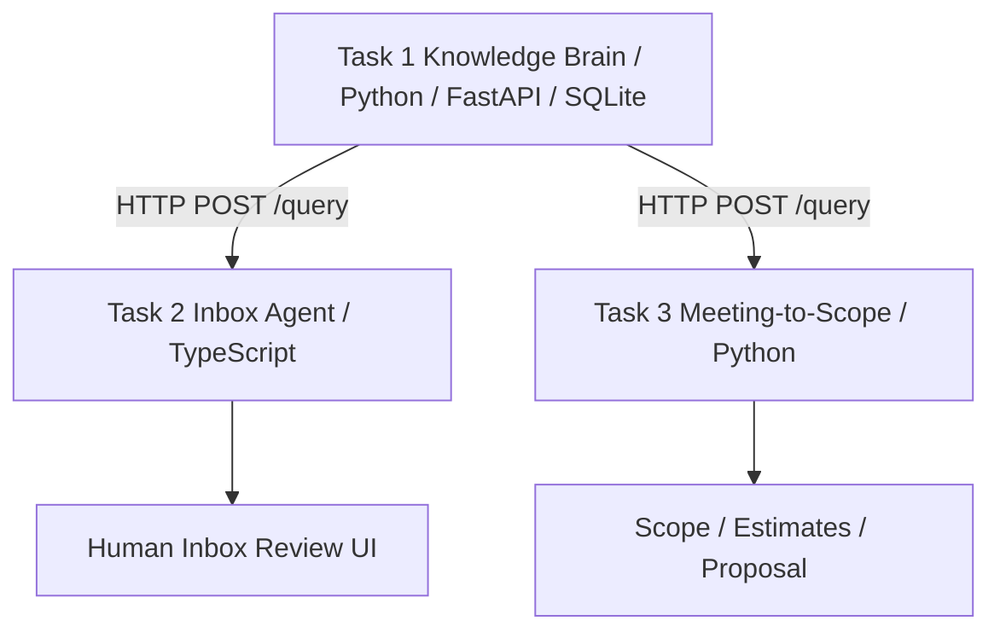

# Design — AI Tech Consultant

## Architecture

The Knowledge Brain is a shared service. Downstream tasks use its HTTP API and do not import its retrieval internals. SQLite keeps local setup simple. Lexical retrieval is transparent and cheap but weaker than embeddings or hybrid search. Claude is optional and used only when configured. Human review is required; email delivery is simulated.

## Safety
Requests are validated, HTTP calls have timeouts, unsupported questions are escalated, and prompts treat email/article text as untrusted. No refunds or actual emails are sent. Keep credentials in `.env`, never in source control.

## Deferred
Embeddings/vector DB, vision-based screenshot descriptions, daily scheduler, deleted-page reconciliation, authenticated multi-user access, automated expert-answer indexing, stable requirement matching, real email integration, and full measured model comparison.
